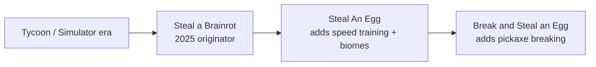

# Roblox "Steal" Game Research

A study of three top "steal-a-X" Roblox games: why they blew up, how their UI works, and how they are probably built.

## Games
| Game | Place ID | Creator | Active (CCU) | Visits | Like % | Server size |
|---|---|---|---|---|---|---|
| [[Steal a Brainrot]] | 109983668079237 | BRAZILIAN SPYDER | 97,826 | 74,017,105,519 | 85% | 8 |
| [[Steal An Egg]] | 107778070777162 | and Collect Rare Pets | 1,810,793 | 8,585,074,123 | 92% | 7 |
| [[Break and Steal an Egg]] | 114326934417838 | ILGames x Eggs | 216,714 | 163,589,373 | 98% | 7 |

*Numbers come from the user's screenshots, taken on 2026-10-18.*

## Concepts (cross-game analysis)
- [[Steal Genre Formula]]: why these games work
- [[UI Patterns]]: HUD, shop, base, popups
- [[Technical Architecture]]: how to build one in Roblox Studio
- [[Monetization]]: gamepasses, dev products, events
- [[Marketing and Thumbnails]]: clickable icons, names, trend-riding
- [[Build Your Own Checklist]]: action plan for your own game

## Lineage

