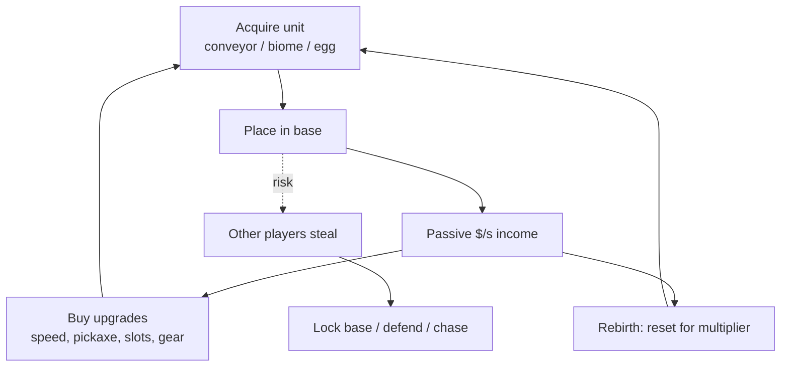

# Steal Genre Formula

All three games run on the same engine:

## The 7 pillars
1. **Idle income:** you earn money even while doing nothing, so every session pays off and logging off feels fine because the base keeps earning.
2. **Gacha rarity:** Common → Secret, plus mutations. Variable rewards keep people playing.
3. **Loss aversion:** your base can be robbed, so you stay online to guard it. This pushes **session length**, which is the metric Roblox's algorithm cares about most.
4. **Social conflict:** theft creates stories, revenge and YouTube/TikTok clips. Small servers (7–8 players) make it personal.
5. **Huge numbers:** quadrillions per second. Big numbers feel good and look good in thumbnails.
6. **Timed events and spawns:** rare spawns every X minutes and admin-abuse events reward staying online.
7. **Rebirth:** endless content without new assets, because players replay the same loop with a multiplier.

## Evolution across the three
| Feature | [[Steal a Brainrot]] | [[Steal An Egg]] | [[Break and Steal an Egg]] |
|---|---|---|---|
| Source of units | Conveyor | Biomes (gated by speed) | Breakable eggs |
| PvE threat | — | Guardian monsters | Sleeping guardian |
| Upgrade stats | Gear, slots | Speed | Speed + pickaxe + pen |
| Hook IP | Brainrot memes | Pets/dinos | Pets/animals |
| Gacha layer | Rarity | Rarity + mutations | Rarity + egg hatch |
