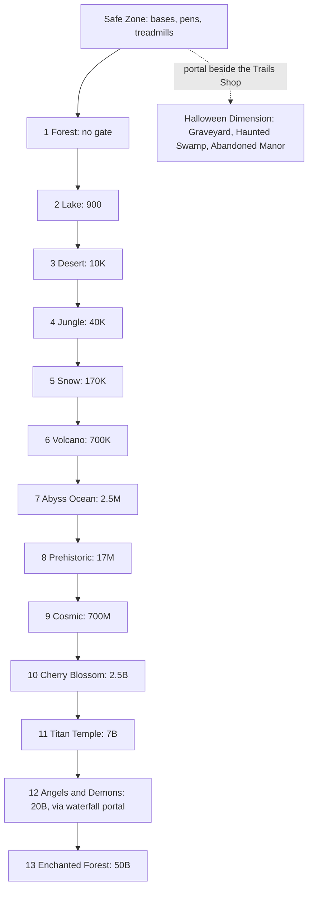

# Steal An Egg

![[steal-an-egg.webp]]

> [!info] About this research
> Deep dive compiled on 2026-10-18 from 294 web pages: fan wikis, guide sites, patch-note articles and news. None of them is official developer documentation, and many guides mix in look-alike games. Conflicts are noted inline, and "(unconfirmed)" marks single-source or unverified figures.

## Overview

| Stat | Value |
|---|---|
| Place ID | 107778070777162 |
| Creator (Roblox group) | and Collect Rare Pets |
| Released | July 25, 2026 |
| Visits | 8,585,074,123 |
| Players online (CCU) | 1,810,793 |
| Favorites | 8,139,674 |
| Likes / dislikes | 3,626,826 / 321,359 (92% liked) |
| Server size | 7 players (7 plots), no private servers |
| Codes | None, ever (no redeem box) |

*Stats from the user's screenshots, 2026-10-18.*

**What it is:** a "steal-a-X" game built on the [[Steal a Brainrot]] template (steal a thing, bring it home, it earns cash). You steal eggs from guarded nests, hatch them into pets that earn money every second, and spend that money on Speed so you can reach farther, richer biomes. It is the biggest game of the three studied here.

**Core loop:** **train Speed on the treadmill → walk out along the lane of biomes → grab an egg from a guarded nest → outrun the guardian (and rival players) → place the egg in your pen → hatch it → the pet earns $/s → buy more Speed → reach the next biome**

- **Speed is the only gate.** There are 13 main biomes in one straight line, each with a Speed sign, plus a 3-biome Halloween Dimension (Update 9).
- **Guardians:** each biome's nests are watched by a sleeping guardian that wakes and chases you when you grab an egg. This adds PvE tension.
- **Eggs have rolled weight (kg) and mutations.** These set the pet's income and how much the egg slows you down.
- **PvP is interception in the field** with bats and bear traps. There is no base lock.
- **Weekly Saturday updates** add a new, higher biome or event system.

## Map layout

The 13 main biomes run in **one long straight line** outward from the players' bases and the shared **Safe Zone** (medium confidence). Each biome farther out needs more Speed and has rarer eggs, so the best eggs need the longest and most exposed run home. Guides describe near, mid and far bands. New biomes are added at the far end of the line, roughly weekly. Update 9 broke that pattern: the Halloween Dimension is reached through a portal at spawn.

- **Biome entrances:** each has a sign showing its Speed number. Angels and Demons is reached through a waterfall portal, and you cannot use portals while carrying an egg.
- **Nests:** each biome has its own nests, with the guardian asleep beside them.
- **Safe Zone:** players' pens sit here. Nothing can attack you, bats show a warning and do nothing, and bear traps cannot be placed. Each player's treadmill sits directly in front of their base.
- **Spawn and lobby fixtures:**
  - Trails Shop
  - Free Rewards area (a red-and-gold chest)
  - Halloween portal beside the Trails Shop
  - Sell stand next to the Fuse Machine (one guide puts the Fuse Machine at your base instead)
  - Rift Machine
  - Rift Shop crystal in the central base yard, which shows an "E Locked" prompt until you meet its requirement
  - Sakura Incubator
  - Stellaris, the star-shop NPC
- **Unknown:** exact distances in studs, whether every base shares one lane or faces its own, and how the 7 plots are assigned. No source has a map image.

Contrast: [[Break and Steal an Egg]] arranges 9 zones radially around a central Safe Zone instead of in a line.

## Areas

| # | Biome | Speed sign | Guardian | Notable eggs / pets (base $/s, hatch time) | Top pet $/s |
|---|---|---|---|---|---|
| 1 | Forest | None | Chicken | Chicken $1 (10 s), Dog $2 (15 s), Bird $8, Owl $35, Raccoon $45, Fox $180, Bear $240, Brr Brr Patapim (Legendary) $1.8K (5 min) | Brr Brr Patapim $1.8K |
| 2 | Lake | 900 | Swan | Frog $3 (15 s), Duckling $4 (unconfirmed), Catfish $12 (sells for 2K), Turtle $60, Swan (2 min), Axolotl (Legendary) $2.8K (5 min), Mangolini Parrochini, Leviathan (Cosmic, 25 min) | Leviathan $220K |
| 3 | Desert | 10K | Scorpion | Jerboa (Common) $6 (20 s), Fennec (30 s), Camel (45 s), Snake (Legendary) $3.6K, Sand Spider (Mythic) $16K (4 min), Scorpion (Mythic) $18.5K, Royal Sphinx | Royal Sphinx $280K |
| 4 | Jungle | 40K (one list: 50K) | Tiger | Tiger $28K, King Snake (Secret, 1 h 30 min). Other pets not fully listed | King Snake $3.5M |
| 5 | Snow | 170K | Yeti | Polar Bear (2 min), King Mammoth $400K, Ice Dragon (Eternal, 4 h), the first Eternal egg. Index reward: Ice Bat | Ice Dragon $65M |
| 6 | Volcano | 700K | Cerberus or Hellhound (varies by source) | Flaming Bull $9.5K, Cerberus (Secret) $8M, Lava Dragon (Eternal) | Lava Dragon $100M |
| 7 | Abyss Ocean | 2.5M | Beluga Whale "Moby" (or a generic deep-sea guardian) | Shark (4 min), Kraken $15M, El Maja | El Maja $130M |
| 8 | Prehistoric | 17M (games.gg: 18M) | T-Rex | Dodo (Rare, 1 min 30 s), Pterodactyl (Legendary, 3 min), Ankylosaurus (Mythic) $120K (5 min), Bronto $1.5M, Tralaledon (Secret, 3 h), T-Rex (Secret, 3 h; Huge egg about 1 h), Mosasaurus (Eternal, 6 h) | Mosasaurus $180M |
| 9 | Cosmic | 700M (one outlier: 450M) | Cosmic Skeleton Boss, Dragon or Dragon King (varies) | Centipede (Epic, 2 min), Cosmic Gorilla (Mythic, 7 min), Unicorn (Divine, 12 h), Huge Cosmic Egg | Unicorn $1B |
| 10 | Cherry Blossom | 2.5B (about 3.5B with a heavy egg) | Oni Tiger (also called Ghost Tiger or nine-tailed fox) | 8 pets, including Crane (Epic) $4K (3 min), Oni Tiger (Eternal) $600M (8 h), Kitsune (Divine, 12 h). Sakura Incubator, Great Bloom. Index reward: Katana | Kitsune $1.8B (one source: $3.2B) |
| 11 | Titan Temple | 7B | Gorilla King | 8 pets: Nightflame (Divine, 16 h), Gorilla King (Eternal) $880M (one egg weighed 19M kg), Mutant Shark, Rhinotaur, Mantaris, Bladehide, Crustacia (Legendary), Spideron (Legendary). Third-rarest egg spawns. Index reward: Titan Axe | Nightflame $3B |
| 12 | Angels and Demons | 20B | Celestial or Demon guardian, by the night's form | 16 animals (8 Light, 8 Dark). Tops: ArchAngel and World Burner (about $5B/s). Luminous Egg, team rings, Secret Shrine. Index reward: golden spear (one source) | Aetheron about $6.9B (Shrine fusion only) |
| 13 | Enchanted Forest | 50B | Enchanted Lion, Celestial Sunlion or starry lion (varies) | 8 pets, including Starry Fox (Secret, spawns loose in the open), Royal Sky Whale (Divine, 20 h), Celestial Sun Lion (Eternal, 11 h). Wisp questline, Butterfly Bloom, 2 secrets, fusion room. Index reward: Hammer | Spirit World Guardian about $26B (unconfirmed; fusion room) |
| 14 | Graveyard (Halloween Dimension) | Unknown | Unknown | 6 new pets (names not found). Candy Corn currency from defeating dimension dwellers | Unknown |
| 15 | Haunted Swamp (Halloween Dimension) | Unknown | Unknown | 6 new pets (names not found) | Unknown |
| 16 | Abandoned Manor (Halloween Dimension) | Unknown | Unknown | 6 new pets. Secret Blood Moon Eggs spawn here | Unknown |

**Notes and conflicts**
- **Forest:** one map guide says 5 Speed, but that matches Break and Steal an Egg's Forest gate, so it is probably mixed up with that game. Beginners start here.
- **Lake and Cosmic (Eldorado weight-class table):** Lake needs about 920 Speed with a very light egg and about 1.2K with a very heavy one. Cosmic needs about 715M (very light) to 840M (very heavy), which supports the 700M sign.
- **Cherry Blossom:** carrying a heavy egg or a Kitsune out takes about 3.5B in practice, which explains the one "3.5B" source. One older source says entry needs a Crane pet, but three guides say the Crane unlocks the Sakura Incubator, not the biome.
- **Hard gates?** Titan Temple is described by one page as "closed until you reach that Speed". Enchanted Forest's NPC or guardian reportedly does not spawn for you below 50B.
- **Angels and Demons:** the form re-rolls each night. Light form spawns Light eggs, Dark form spawns Dark eggs, and a rarer Merged night opens both pools with bonus luck. A Luminous 10x mutation is mentioned once.
- **Spirit World Guardian:** its Huge egg takes 3 d 12 h to hatch.
- **Abandoned Manor:** one source says it opens in a later update, which conflicts with the patch notes that list it as open.
- **Desert guardian:** one guide lists Swan, which other sources treat as an error.
- **Biome count:** guides say 9, 10, 11, 12 or 13 depending on when they were written. One aggregated list puts a "Brainrot" area between Cosmic and Cherry Blossom; most sources treat Brainrot as a store or event egg only.
- **Pet and egg counts** vary by source and date: 72, 78, 86, 87, 104, 114, 128, 149-157, 198 or 213 pets. One wiki said each biome has exactly 8 eggs (88 across 11 biomes). Eldorado counts 141 eggs across 13 biomes plus events and the premium shop.

## Speed training

Speed is the only progression gate between biomes. It is stored server-side, and no infinite-speed glitch works. It shows at the bottom-left beside a shoe icon (one source).

### Treadmill tiers
The treadmill is the only unlimited Speed source. Each step adds a fixed amount, and each tier unlocks after the previous one. You can walk or AFK on it. One guide says it appears once you spend $1,000 on the first garden upgrade.

| Tier | Rarity label | Speed per step | Cost |
|---|---|---|---|
| Base | Common | +2 | Free |
| Sci-Fi | Uncommon | +5 | $15K |
| Flame | Rare | +12 | $250K |
| Celebrity | Epic | +30 | $5M |
| Golden | Legendary | +80 | $120M |
| The Freeze | Mythic | +100 | $3B |
| Lucky Block | Cosmic | +200 | $75B |
| Hacker | Secret | +500 | $3T (LOLGA: $2T) |
| Demonic | Eternal | +1K | $50T |
| Angelic | Divine | +2K | $1Qa |
| Astral (MAX) | Divine | +3K | $15Qa |

- Eldorado, rblxguide and LOLGA agree on 11 tiers. Gameboost says 10.
- Costs rise roughly 20-40x per level.
- **Conflicts:**
  - allthings.how says Level 2 gives +20/step and Hacker gives +11K/step.
  - Another guide says early treadmills give about 10-24 Speed per step.
  - A "Guardian Treadmill" at $7.5Qa is mentioned once.
- **Boosters:** a 2x Treadmill Booster (200 Boss Tokens) and temporary event-shop Treadmill boosters.

### Trails
Trails multiply only treadmill gains, give nothing off the treadmill, and you can equip one at a time.

| Trail | Multiplier | Cash price | Robux price |
|---|---|---|---|
| Gray | 1.5x | $100 | - |
| Green | 2x | $5,000 | 8 R$ |
| Blue | 2.5x | $75,000 | 12 R$ |
| Purple | 3x | $1.5M | 19 R$ |
| (middle tiers not captured) | | | |
| Secret | 7x | not captured | - |
| Eternal | 10x | $12.5T | - |
| Divine | 14x | $13T (rblxguide: $300T) | - |
| Moonbloom (rblxguide only) | 20x | not captured | - |

allthings.how lists 10 trails. rblxguide lists 11, topping out at Moonbloom 20x. Guides say to upgrade the treadmill first, then buy the best trail you can afford before a long session.

### Other Speed sources
- **Free +10,000 Speed** for liking, favoriting and joining the "and Collect Rare Pets" group. You claim it at the Free Rewards chest near spawn.
- **Pet Index rewards:** a one-time reward of Speed plus cash for the first pet of each species, scaling with rarity. Examples: Chicken +420 Speed and $100; Brr Brr Patapim +1K and $180K; Duckling +2.2K and $400; Crane +2.7M and $400K (one source). Values conflict between sites.
- **Robux:** flat Speed packs and Speed multipliers (see [[#Monetization]]).
- **Boosters:** a 1.25x Speed booster from the Boss Shop, and temporary Speed boosters from event shops.

### Weight penalty
Egg weight lowers your Speed while you carry it, so the number on the sign is a floor, not a safe speed. How much you need above it:
- About 20% above the sign (allthings.how).
- 15-20% above for heavy eggs, so a 17M zone is treated as 20M+.
- 2-3x the sign, or about double it before farming a new zone.

Example: Cherry Blossom's 2.5B sign needs about 3.5B with a heavy egg or a Kitsune. One guide says zig-zagging also cuts your Speed, while another says it confuses the guardian AI. A consumable speed multiplier reportedly reduces the carry penalty. The penalty formula (linear per kg, or by weight class) is unknown.

### Gate ratios
Most steps are 2.5-4x the previous gate, with three big walls (ratios worked out from the consensus signs):

| Step | Gates | Ratio |
|---|---|---|
| Lake → Desert | 900 → 10K | about 11x, "the first real grind wall" (games.gg) |
| Desert → Jungle | 10K → 40K | 4x |
| Jungle → Snow | 40K → 170K | about 4x |
| Snow → Volcano | 170K → 700K | about 4x |
| Volcano → Abyss Ocean | 700K → 2.5M | about 3.6x |
| Abyss Ocean → Prehistoric | 2.5M → 17M | about 7x, "the speed wall" |
| Prehistoric → Cosmic | 17M → 700M | about 40x, the biggest jump |
| Cosmic → Cherry Blossom | 700M → 2.5B | about 3.6x |
| Cherry Blossom → Titan Temple | 2.5B → 7B | about 2.8x |
| Titan Temple → Angels and Demons | 7B → 20B | about 2.9x |
| Angels and Demons → Enchanted Forest | 20B → 50B | 2.5x |

Guides advise spending dead time, such as the night reset, on the treadmill, and upgrading it as soon as you can afford to. The treadmill launched with a TikTok-style "Reels" feed. See the warning under [[#Monetization]].

## The egg-steal flow

1. **Reset and night.** About every 5 minutes (high confidence), roughly 4:40-4:50 of play is followed by a short "night" or closed-map window: 10 s (Eldorado) or 13 s (a Sportskeeda-type guide). IGN, as cited, says about 4.5 min.
   - All players are teleported back to the Safe Zone. A disconnect glitch that dodged this teleport is reportedly patched, and staying offline too long gives Error 277.
   - All nest stock resets.
   - Eggs already in pens grow 30x faster during the night.
   - The Angels and Demons form re-rolls.
   - One guide says stealing shuts off at night; others describe only the teleport.
2. **Spawn roll.** Each biome restocks its nests from its own pool of about 8 egg species, and rarity rises with distance from base.
   - **Size:** each egg's weight (kg) is rolled per server at spawn and stays fixed, which is why players server-hop for heavy eggs.
   - **Mutations:** Silver, Golden and Rainbow roll naturally at 6 / 4 / 1 per 100. Sources disagree on whether this happens at spawn (visible on the shell) or at hatch.
   - **Rare eggs:** Secret, Eternal and Divine eggs roll at random each reset (about 0.051%, 0.046% and 0.008%). When one spawns, the whole server is told its name and biome.
   - **Event eggs** (Brainrot, Rift, Monster and similar) never spawn in nests. Exceptions to the nest rule: Starry Fox spawns loose in the open Enchanted Forest, Blood Moon Eggs spawn in Abandoned Manor, and Admin Abuse events drop high-rarity eggs.
   - No source gives the number of eggs per nest.
3. **Choose a biome.** Walk out of the Safe Zone along the line and read the Speed sign at the entrance. Most guides call it a soft gate: you can walk in at any Speed, and the number is what you need to outrun the guardian on the way back. Titan Temple and Enchanted Forest are the possible exceptions.
4. **Inspect.** The guardian sleeps beside the nests. Each egg shows its weight (kg) and mutation (shell color) before you take it. Bigger eggs pay more but are heavier.
5. **Grab.** Press **E** (or tap on mobile) on the "Steal Egg" proximity prompt. A grab animation plays, and higher-tier eggs reportedly take longer. Whether it is a tap or a hold prompt is unknown. Guides recommend one egg per trip; whether you can carry several is unresolved.
6. **Guardian wakes.** Most sources say picking up the egg wakes the guardian, which chases you immediately, with no sneaking. One guide says it turns red and gets faster the farther you run. Bloxron is the outlier, saying some sleeping guards near Lake let you grab without a chase. Most sources describe a fixed pursuit speed per biome: you escape only if your Speed after the weight penalty is higher.
7. **Run home.** Run straight. Drop bear traps behind you to root the guardian. Watch for rival players with bats and traps, who can make you drop the egg. You cannot use portals while carrying; an exploit at the Angels waterfall portal works because the game checks this only once, on contact.
8. **Caught.** You are ragdolled or flung away and drop the egg. Sources disagree on what happens next:
   - It returns to the nest if you were caught in the guardian's own biome (Bloxron).
   - It stays on the ground if you were caught in an earlier biome (Bloxron), where anyone can pick it up (Sportskeeda).
   - You respawn at base and the egg is lost (stealanegg.pro).
   - **Known trick:** drop the egg just before the hit, and the guardian gives up and walks back to its post. This lets you move a heavy egg home in stages.
9. **Escape.** The chase ends when you cross back into your own garden or Safe Zone perimeter (stealanegg.pro, stealanegg.fans). Some guides say certain guardians give up at their biome border, which makes you safe from the guardian but not from players.
10. **Deliver.** A steal counts only when you place the egg in a free pen slot; if your pen is full, you must remove something first. The egg then counts down to hatch, from 10 s for a Forest Chicken up to 12-20 h for Divines and 3.5 days for Huge boss eggs, and heavier eggs take longer. Most sources say you press the hatch button at 0; others say it hatches automatically. The pet earns $/s in the pen with no collecting step.
11. **Spend.** Cash goes into treadmill and trail upgrades for more Speed, which lets you farm the next biome. Pen upgrades add slots.

> [!tip] Builder's note
> Glitch guides describe guardians getting stuck on walls, in Titan Temple corners and near the Sakura Incubator. Guides call these pathfinding bugs that tend to get patched. A clone such as [[Steal a Beast - Overview]] needs robust guardian pathfinding plus leash and return logic.

## Player-vs-player

**Servers:** 7 players and no private servers. Players avoid PvP by sorting servers by "Fewest Players" or by filling the slots with alt accounts; guides say it is unclear whether the alt trick is allowed under Roblox rules.

### Bats and weapons
Everyone starts with a weak, very short-range baseball bat (rated D tier). Completing all 8 pets of a world's Pet Index unlocks that world's stronger weapon. Weapon stats are **Force** (knockback), **Duration** (ragdoll seconds) and **Range Bonus**. These are controller config values, not measured knockback. Swing cooldown is unknown.

| Weapon | Source | Stats / notes |
|---|---|---|
| Baseball Bat | Starter | D tier, must almost touch the target |
| Ice Bat | Snow Index | The first real upgrade for most free players |
| Katana | Cherry Blossom Index | Force 82.528, Duration 1.179 |
| Titan Axe | Titan Temple Index | Force 90.781, Duration 1.297 (about 1.3 s ragdoll), Range Bonus 18.75. One guide says it hits 159% harder than the Bat |
| Golden spear | Angels and Demons Index (one source) | One site calls it the top weapon |
| Hammer | Enchanted Forest Index | S tier on stealanegg.fans, where the Titan Axe is A tier |
| Flyswatter | 5% roll from Monster Chests | Force 50 / Duration 1.5 (GameBoost) vs Force 35 / Duration 1.03 (stealanegg-wiki) |
| Bee Gun | Limited egg Index (one guide) | Described as effective at taking eggs |
| Scrambler | Dr. Scramble event (5-part Stolen Experiment Vault) | Limited melee bat with knockback |

- **Other sources:** the Rift Shop, Admin events and Pet Index bat skins.
- **Weapon counts:** one wiki counts 11 world collections that unlock weapons, and another counts 14 weapons in total.
- **Removed:** slaps were sold early on and have since been removed; only the Flyswatter remains. Diamond and Rainbow Slap belong to Pull an Egg.
- **Strongest weapon** is disputed: Titan Axe, Hammer or golden spear.

### Bear traps
- **Getting them:** bought with coins and placed from your inventory. Some come from rewards, and supply is limited at first.
- **Limits:** at most 3 on the map, and none in the Safe Zone.
- **Effect:** roots whoever steps on it for **5 s** (Bloxodes, allthings, Sportskeeda) or **7 s** (rblxguide, Fandom), and the target drops their egg. Fandom says traps only trigger on players carrying an egg. They also root chasing guardians.
- **Uses:** drop one behind you when chased, on common routes home, near rare-egg nests, or at your own base entrance.

### Knock loose, then grab
1. **Intercept** carriers at narrow biome chokepoints or just outside a rival's pen. Heavy eggs make carriers slow and easy to hit. Chasing across open ground rarely works unless you are clearly faster.
2. **Knock loose:** a bat hit ragdolls and flings the carrier, and a trap freezes them. Either way they drop the egg.
3. **Grab:** anyone nearby can press E on the dropped egg, including the victim, and the first one wins. Guides say to grab it immediately, and that a fight is only worth it for Legendary or better eggs.
4. **Carry home:** you now face the same weight penalty, bats and traps, and you cannot use portals. The steal counts only when the egg is in your own pen.

### Safe Zone
Bats show a warning and do nothing inside it, so all PvP happens out in the field. Server-wide rare-egg announcements send every player racing to the same nest, which creates PvP hotspots.

### Pen raiding (unresolved)
GameBoost and one aggregator say rivals can walk into your plot and take unhatched eggs, or even pets, from your pen. allthings.how says eggs cannot be stolen once they are at your base or hatched. No source describes the prompt for taking from someone's pen.

### Extras
- One PvP guide mentions troll gear that inverts controls or shakes the camera and costs more than a bat or trap. Names and prices are unknown.
- Mounts (Update 8) give no Speed, carry-weight or guardian bonus.
- No speed coil, invisibility cloak, web slinger or grapple was found; those belong to the Brainrot genre. TikTok clips mention a Radioactive Hammer, a banjo and a butterfly net, without official details.

## Base and defense

**There is no base lock, shield, laser door or lock button** in the official Steal An Egg (medium confidence; several targeted searches found none). No raid alert is documented, and there is no safe mode or new-player protection (GameBoost).

Defense rests on three things:
1. **The Safe Zone**, which holds the pens. Bats do nothing there, and traps cannot be placed there.
2. **Up to 3 bear traps** at your base entrance or along your route.
3. **A short exposure window:** hatch fast (X2 Growth, Grow All, Instant Hatch, the 30x night boost), keep trips short and watch for nearby players.

One wiki alone lists "Walls and Turrets" defense upgrades (low confidence; possibly another game). Lock and shield mechanics appear only in Steal a Brainrot and in a third-party itch.io "Egg Heist" template, which has laser-door locks, shields and lock timers on a base panel.

### Pen levels
The pen is a single area with no floors. It caps how many pets are earning at once, starts at 7 and is upgraded with cash.

| Level | Cost | Active pets |
|---|---|---|
| 1 | 1K | 7 |
| 6 | 50B | 13 |
| 11 | 500T | 18 (stealanegg-wiki says this is MAX) |
| 12 (MAX) | 5Qa | 19 |

- **Source:** LOLGA and Fandom list 12 levels. The other levels were not captured.
- **Cost jump:** costs go from millions to billions between Lv5 and Lv6.
- **Slots:** not every level adds a slot. "+1 EQUIP" is quoted at $75M and $1B.
- **Equip Best:** a button that fills the slots with your top earners.
- **Not this game:** a 19-level, 25-pet table belongs to Steal Animal Egg.

**[[Steal a Brainrot]], by contrast:**
- Your base locks for 30 s when you join.
- A lock button gives 60 s of protection plus 10 s per rebirth; one guide says 50 s.
- While locked, red laser gates let only the owner through.
- Thieves wait out the lock; a thief carrying a Brainrot is slowed, and the owner can hit them to make them drop it.

## Hatching and income

### Placing and hatching
- **Placing:** put the stolen egg in a free pen slot. A countdown shows on the egg and keeps running while you are away.
- **Hatching:** most sources (roonby, allthings.how) say you press the hatch button in the pen at 0. Others say it hatches automatically.
- **The pet:** it is the species named on the egg (a Sand Spider Egg hatches a Sand Spider) and keeps the egg's weight. Weight does not grow during incubation.
- **Unknown:** whether hatch slots are separate from active-pet slots.

### Hatch timers

| Band | Examples |
|---|---|
| Common and early eggs | Seconds: Chicken 10 s, Dog 15 s, Frog 15 s, Jerboa 20 s, Fennec 30 s, Camel 45 s (a fresh-account Forest egg took 13 s) |
| Rare to Mythic | Minutes (Epic to Mythic about 1.5-7 min): Dodo 1 min 30 s, Centipede 2 min, Crane 3 min, Pterodactyl 3 min, Sand Spider 4 min, Brr Brr Patapim 5 min, Ankylosaurus 5 min, Cosmic Gorilla 7 min. One wiki says a Mythic takes about 5 h |
| Cosmic | Leviathan 25 min |
| Secret | 1.5-3 h: King Snake 1 h 30 min, T-Rex 3 h, Tralaledon 3 h |
| Eternal | 4-11 h: Ice Dragon 4 h, Mosasaurus 6 h, Oni Tiger 8 h, Celestial Sun Lion 11 h |
| Divine | 12-20 h: Unicorn 12 h, Kitsune 12 h, Nightflame 16 h, Royal Sky Whale 20 h |
| Huge boss eggs | About 1 h (T-Rex) to 3 d 12 h (Huge Spirit World Guardian) |

Heavy rolls take longer: a giant Stag took 14 h and a 9M-kg Secret took 20 h.

**Speeding up hatches:**
- The free 30x night boost.
- The X2 Growth Speed pass.
- Grow All: about 160 R$ per batch, though one article calls it a free button in the "Growing Eggs" menu.
- Instant Hatch: about 9 R$ per egg.

### Income formula
Pets in the pen add cash every second automatically. There is no collect pad, unlike Brainrot.

**Income = base × mutation multiplier × size multiplier**

- **Community weight formula:** multiplier = (weight / base weight)^(37/60), about ^0.617, up to 125x base weight, with slower growth beyond that. Example: a Unicorn with a 1,200 kg base weight is x1.53 at 2,400 kg and x2.7 at 6,000 kg.
- **Real example:** a 2,536,813 kg Bronto earned about $21M/s against a $1.5M/s base.
- **Weight range:** from tens of kg (a 61 kg Celestial Sun Lion) to tens of millions of kg (a 19M-kg Gorilla King egg).

### Income by rarity

| Rarity | Base $/s (wikirealm) | Wider ceilings (Eldorado/Gameboost) |
|---|---|---|
| Common | $1-6 | |
| Uncommon | $8-18 | |
| Rare | $35-280 | |
| Epic | $180-4K | |
| Legendary | $1.8K-225K | up to $550M |
| Mythic | $16K-1.25M | |
| Cosmic | $220K-25M | |
| Secret | $3.5M-350M | $1.25M-2.5B |
| Eternal | $65M-1.8B | |
| Divine | $1B-6.9B | up to $26B |

### Best pet per biome (the money curve)

| Biome | Early pick (Timesaver) | Best pet |
|---|---|---|
| Forest | Bear $240 | Brr Brr Patapim $1.8K |
| Lake | Axolotl $2.8K | Leviathan $220K |
| Desert | Scorpion $18.5K | Royal Sphinx $280K |
| Jungle | Tiger $28K | King Snake $3.5M |
| Snow | King Mammoth $400K | Ice Dragon $65M |
| Volcano | Flaming Bull $9.5K | Lava Dragon $100M |
| Abyss Ocean | Kraken $15M | El Maja $130M |
| Prehistoric | - | Mosasaurus $180M |
| Cosmic | - | Unicorn $1B |
| Cherry Blossom | - | Kitsune $1.8B |
| Titan Temple | - | Nightflame $3B |
| Angels and Demons | - | Aetheron $6.9B |
| Enchanted Forest | - | Spirit World Guardian about $26B (unconfirmed) |

**Offline:** pets keep earning and eggs keep growing at a "significantly lower" rate. The exact rate and cap are unknown. Guides advise logging off with a full pen.

### Sell, fuse, rift and Index
- **Sell stand** (lobby): unequip a pet to sell it for a fixed price, permanently (a Catfish sells for 2K). You can also sell a carried egg, priced by weight and zone; empty-handed, you get "No item equipped". No full price table was found.
- **Fuse Machine:** 3 pets of the same species plus a cash fee give 1 egg of that species with a re-rolled size, and a chance at Golden or Rainbow. Example fees: 3 Pterodactyls 48M; 3 Scorpions $114M; late-game species tens to hundreds of billions. It is a reroll, not a guaranteed upgrade: 3 Scorpions totalling 960 kg produced an 86 kg Scorpion. Mixed species are rejected, and there is no cooldown.
- **Rift Machine:** 3 specific animals craft a Rift Egg (Riftborn 45%, Riftbeasts 35%, Shattered Rift 20%).
- **Special fusions:** the Secret Shrine turns ArchAngel and World Burner into Aetheron. The Enchanted Forest fusion room makes the Spirit World Guardian.
- **Pet Index:** a one-time Speed and cash reward per new species (per-pet Claim buttons plus "Claim All"), plus a weapon or bat skin for completing a world. Guides say Index rewards matter more than the treadmill early on.
- **Trading:** not in the game (Eldorado).

## Rarities and mutations

### Rarity ladder (10 tiers, high confidence)

| # | Rarity | Spawn odds | Notes |
|---|---|---|---|
| 1 | Common | | |
| 2 | Uncommon | | |
| 3 | Rare | | |
| 4 | Epic | | |
| 5 | Legendary | | |
| 6 | Mythic | | |
| 7 | Cosmic | | |
| 8 | Secret | about 0.051% (1 in 1,960) | Server-wide spawn alert; hatch badge |
| 9 | Eternal | about 0.046% (1 in 2,170) | Server-wide spawn alert; hatch badge |
| 10 | Divine | about 0.008% (1 in 12,500) | Server-wide spawn alert; hatch badge |

There is no official odds table, and rarity colors are not documented.

**Egg sizes:** eggs are labeled Small, Medium and Huge/Giant, with a continuous kg weight. The size multiplier follows the weight formula; one calculator's Giant x3 / Huge x5 labels are unverified. Huge boss eggs exist for guardian species.

### Mutations

| Mutation | Current multiplier | Launch-era | How to get it |
|---|---|---|---|
| Silver | x1.2 | x1.25 | Natural roll (6 per 100) |
| Bloom | x1.25 | x1.5 | Sakura Incubator at 100% charge (97.5%) |
| Golden | x2.5 (allthings: x2) | x2 | Natural roll (4 per 100), Admin Abuse, Fuse Machine |
| Spirit Bloom | x2.5 | x3 | Sakura Incubator (2.5%). Some guides claim 150% charge guarantees it |
| Fractured | x2.75 | - | Shard from the Rift Boss Shop (400 Boss Tokens, 10% success) |
| Scrambled | x2.75 | - | Dr. Scramble's Experiment Shop (475 Samples; 10% or 1% apply chance) |
| Nitro | x2.75 | - | Listed in Eldorado's table; source not documented |
| Parasite | x3 | - | Parasite Eggs from the Hungry Frog event |
| Rainbow | x3.5 | x2.5 | Natural roll (1 per 100), Admin Abuse, Fuse Machine |
| Luminous | x10 (unconfirmed) | - | Mentioned once (Angels and Demons update) |

- **Sources:** current values come from the newer guides (rblxguide Oct, Eldorado Oct, allthings Sep, u7buy). The mutation count is quoted as 5, 7, 8 or 10. "Abyssal" is unconfirmed.
- **Sakura Incubator:** you unlock it by submitting a Crane, then charge it with Sakura Crystals (about 1.5K). You get the crystals by hitting trees during the Great Bloom, which comes every 30 min and lasts 3 min. Robux can top up the charge.
- **Applying consumables:** they go on a placed, unhatched egg, and two can stack for a double mutation. Whether stacking is additive or multiplicative is disputed: eggipedia lists Golden + Rainbow as x5, while another guide describes additive bonuses (for example, Scrambled as +1.75 above x1).

## Rebirth

**Probably none** in the official game (low confidence). bo3.gg and stealanegg.app (the newest source) say there is no verified Rebirth and that the official description does not mention one. Speed, treadmill and pen upgrades are the progression instead, and the game prolongs it with weekly new biomes at ever-higher Speed gates rather than resets.

Two unverified outliers, possibly from look-alike games:
- wikirealm claims about +5% pet income per rebirth level, with tiers 5-6 added Aug 12, 2026.
- A third-party calculator (axeetech) claims a $250K base cost scaling 3.5x per tier, resetting Speed and cash.

Look-alikes that do have rebirths: Jump To Steal An Egg (75 Jump Power for x1.5 cash) and Steal and Hatch Anime Eggs (4.1K Speed for x1.5).

## UI elements
- **Counters:** Speed at the bottom-left beside a shoe icon (one source); cash counter position unknown.
- **Biome entrances:** a Speed-requirement sign at each one.
- **"Steal Egg" proximity prompt** (E on PC, tap on mobile), also used to pick up dropped eggs.
- **Egg labels:** weight (kg) and a mutation-colored shell on each egg in the nest; a hatch countdown on eggs in your pen.
- **Night/reset timer** leading into the server-wide teleport to the Safe Zone.
- **Rare-egg alert:** a server-wide notification when a Secret, Eternal or Divine egg spawns, naming the egg and biome.
- **Safe Zone warning** when you try to use a bat or item there.
- **Pet Index button** in the left corner, with per-pet Claim buttons and "Claim All".
- **"Growing Eggs" menu** on the right with a Grow All button.
- **Pen panel** with "Equip Best" and a "+1 EQUIP" slot upgrade.
- **Hatch button** in the pen when the timer ends (most-cited version).
- **Shops:**
  - Speed/Treadmill upgrade shop
  - Trail Shop (cash or Robux price per row)
  - Robux Speed Shop (packs and multipliers)
  - Gamepass shop
- **Free Rewards area,** or a red-and-gold chest near spawn.
- **Machines:** Sell stand ("No item equipped" when empty-handed), Fuse Machine, Rift Machine, Sakura Incubator charge meter.
- **Rift Shop crystal** with an "E Locked" prompt.
- **Event shops:** Boss Shop (Boss Tokens), Experiment Shop (Samples), Stellaris star shop, and a Nitro Race Win Pass.
- **No code-redeem box.**
- **Floating $/s income tags** with huge suffixed numbers (for example "$89,121/s" in the thumbnail; suffixes run K, M, B, T, Qa...). This is inferred from the thumbnail; the full suffix list is undocumented.
- **Badges** for hatching a Secret, Eternal or Divine pet.
- **Not documented:** exact HUD button positions, the hatch animation and how the carried egg is shown. One clone template shows red eyes, chase audio and a pulsing danger effect on guardians, but that is not the official game.

See also [[UI Patterns]].

## Shop and gear
- **Treadmill tiers:** 11, bought with cash, from Base +2 (free) to Astral +3K/step at $15Qa. See [[#Treadmill tiers]].
- **Trails:** 10 or 11 multipliers on treadmill gains, from Gray 1.5x at $100 up to Divine 14x ($13T or $300T) or Moonbloom 20x. Lower tiers can also be bought for a few Robux.
- **Pen upgrades:** 12 levels from 1K (7 pets) to 5Qa (19 pets).
- **Bear traps:** bought with coins, at most 3 on the map; some come from rewards.
- **Bats and weapons:**
  - Starter Bat
  - Index weapons (Ice Bat, Katana, Titan Axe, golden spear, Hammer)
  - Flyswatter, Bee Gun and Scrambler
  - Bat skins from the Index
- **Troll gear** (inverted controls, camera shake): reported by one guide; names and prices unknown.
- **Boss Shop** (Boss Tokens, 1,200-1,500 per Abyss Overlord kill): Fractured Mutation 400, 2x Treadmill Booster 200, Cash Booster 175, 1.25x Speed booster.
- **Dr. Scramble Experiment Shop** (Samples from drones every 30 min): Scrambled mutation for 475 Samples, plus temporary Cash, Speed and Treadmill boosters.
- **Stellaris the Star Handler:** up to 5 Shooting Stars per week (reset Saturday). A star turns a pet into a permanent mount.
- **Machines and shrines:**
  - Fuse Machine
  - Rift Machine
  - Sakura Incubator
  - Secret Shrine (Aetheron)
  - Enchanted Forest fusion room (Spirit World Guardian)
- **Sell stand** for pets and carried eggs.

## Monetization

| Product | Type | Price | Notes |
|---|---|---|---|
| X2 MONEY! | Gamepass | 399 R$ | High confidence. bo3.gg's 239 R$ is likely outdated |
| X2 GROWTH SPEED! (eggs grow 2x faster) | Gamepass | 467 R$ | High confidence. bo3.gg says 340 R$ |
| Grow All Eggs | Consumable | about 160 R$ per batch | Skips all current egg timers. One article calls it a free button |
| Instant Hatch | Consumable | about 9 R$ per egg | |
| Flat Speed packs | Consumable | +150K Speed for 79 R$ up to +1B for 2,999 R$ | Prices in between not captured |
| Speed multipliers | Consumable | 12 tiers: x2 at 3 R$, x16 at 39 R$, x512 at 499 R$, x4K at 1,375 R$ | Another wiki: 10 tiers up to 1024x at 649 R$. A third puts 4,000x at 1,200-1,300 R$ |
| Trails (low tiers) | Consumable | Green 8 R$, Blue 12 R$, Purple 19 R$ | Also buyable with cash |
| Shooting Stars | Consumable | 1,399 R$ for all five (unconfirmed) | Up to 5 per week |
| Sakura Incubator charge top-up | Consumable | Unknown | |
| Limited Brainrot and Monster eggs, paid Extinction Egg (Update 6) | Consumable | Unknown | Expired event eggs can no longer be hatched |
| "$24,000 money pack" | Consumable | Unknown | One user report |

- **Not verified:** a VIP, Lucky or Auto-Hatch pass. stealanegg.pro lists 2x Speed and Auto-Hatch passes, which other sources dispute.
- **No Robux PvP gear** is verified, and there are no codes.
- **Free hooks:** +10K Speed for like, favorite and group join, plus Admin Abuse events.

> [!warning] Do not copy the "Reels" feed
> The treadmill launched with a giant "Reels" screen playing a TikTok-style short-video feed while players ran for Speed, and players could pay Robux to skip it. Commentators compared it to Black Mirror's "Fifteen Million Merits", and Kotaku called the videos mostly "AI slop".
>
> Roblox delisted the game on a Monday in late August 2026, shortly after it hit #1 (more than 500K CCU, close to 300M plays). It was re-uploaded without the feed. Roblox then barred games that combine a media feed, autoplay or infinite scroll, and rewards for continued viewing from Roblox Kids (ages 5-8) and Roblox Select (ages 9-15). Roblox's own rewarded video ads are exempt.
>
> One social post says the game was not banned but had its maturity rating reset. Either way, do not put a feed-for-reward mechanic in [[Steal a Beast - Overview]].

See also [[Monetization]].

## Events and update timeline

Updates come weekly on Saturdays around 15:00 UTC, usually adding a new biome at the far end or a new event system.

**Admin Abuse:**
- **When:** Saturdays, about 8 AM PT / 11 AM ET, lasting 30-60 min. The first was Aug 22 and #9 was Oct 17. Some sources say it only happens at major updates.
- **What:** speed and luck boosts, high-rarity egg drops, an admin treadmill and mutations.

| Date (2026) | Update | What it added |
|---|---|---|
| Jul 25 | Launch | 9 biomes (Forest to Cosmic), stealing, treadmill, hatching |
| Late Aug | Takedown and re-upload | Delisted over the "Reels" treadmill shortly after hitting #1; re-uploaded without the feed |
| Aug 22 | Update 1: Cherry Blossom | Cherry Blossom (2.5B), Sakura Incubator, Bloom and Spirit Bloom, Great Bloom every 30 min. First Admin Abuse |
| Aug 29 | Update 2: Monsters Are Coming | Titan Temple (7B), Hungry Frog, Parasite eggs, Monster Chest |
| Sep 5 | Update 3: Rift Event | Purple rift every 30 min, Abyss Overlord boss (2 phases: crystals, then arms), Boss Tokens, Boss Shop, Rift Machine, Rift Eggs |
| Sep 12 | Update 4: Angels vs Demons | Angels and Demons (20B), nightly Light/Dark/Merged form, 16 animals, Luminous Egg, team rings, Secret Shrine |
| Sep 19 | Update 5: Sammy / Dr. Scramble | Samples, Nibbles, Experiment Shop, drones every 30 min, Scrambler and Vault parts (one researcher found no data) |
| Sep 26 | Update 6: Dr. Scramble's Laboratory / Revenge | 3 banners, 15 pets, paid Extinction Egg, Boss Mastery, egg trade-ins |
| Oct 3 (one source: Oct 4) | Update 7: Enchanted Forest | Enchanted Forest (50B), Wisp questline, Butterfly Bloom, 2 secrets, fusion room |
| Oct 10 | Update 8: Mounts | Shooting Stars turn pets into mounts (Stellaris shop). Nitro Race every 30 min for Trophies (2,500 for 1st, 1,550 for 3rd), Win Pass with 5 race mounts |
| Oct 17 | Update 9: Halloween Dimension | Portal at spawn to Graveyard, Haunted Swamp and Abandoned Manor (6 pets each), Echo the Ghost Dog quest, Phantom Express every 30 min, Candy Corn, Blood Moon Eggs, free Halloween Egg route. Some sources call it an Oct 17-24 event |

**Recurring in-world timers:**
- **Every 5 min:** egg reset and night.
- **Every 30 min:**
  - Great Bloom (lasts 3 min)
  - Rift
  - Dr. Scramble drones
  - Nitro Race
  - Phantom Express
- **Shooting Stars:** come from a rare nightly event, and you must have been in the server since that in-game day began.

## Why it's popular
- **Proven template:** it follows [[Steal a Brainrot]]'s steal-and-earn loop. Brainrot holds the Guinness record of 25,868,678 CCU (Oct 11, 2025), ahead of Grow a Garden's 22.3M.
- **Several proven hooks stacked:** an egg-hatch gacha (Pet Simulator / Adopt Me), a stat-training simulator (treadmill Speed), PvE chase tension from guardians, and light PvP (bats and traps).
- **Spatial progression:** a visible line of biomes with Speed signs gives a clear next goal, and the run home gets longer and riskier as the reward grows.
- **Shared race moments:** server-wide rare-egg announcements and the 5-minute reset create moments everyone chases at once in small 7-player servers.
- **Weekly Saturday updates** plus Admin Abuse events bring players back.
- **Huge escalating numbers:** income runs from $1/s to billions per second and Speed into the billions, and size and mutation rolls keep players chasing.
- **Viral controversy:**
  - The Reels treadmill drew Black Mirror comparisons and coverage from Kotaku, GamesRadar and Dexerto, and the Roblox takedown added to it.
  - Big YouTube coverage helped too: Foltyn's video had about 1.3M views.
  - One X post mentioned accusations that it was "stealing from other games", while saying the takedown was over the treadmill, not copying.
- **Easy onboarding:** +10K free Speed, no codes needed, and Forest has no gate.
- **Reported scale:**
  - #1 on Roblox.
  - About 1.3M CCU on Sep 9 and 1,338,131 live players on Rolimons.
  - 1.81M CCU in the user's screenshot.
  - Reported peaks of 2.2M (RoWatcher, Aug) and 14.2M (a Q3 report claiming 6B visits) conflict and are unverified.

More on why the genre works: [[Steal Genre Formula]].

## Comparison with Break and Steal an Egg

[[Break and Steal an Egg]] is a different game that often gets mixed into Steal An Egg guides.

| | Steal An Egg | Break and Steal an Egg |
|---|---|---|
| Layout | 13 biomes in one straight line outward from the Safe Zone | 9 zones arranged radially around a central Safe Zone, where you train Speed and buy pickaxes |
| Speed gates | Forest 0, Lake 900, Desert 10K ... Enchanted Forest 50B | Forest 5, Desert 1,000, Snowy 50,000, Candy 750,000, Swamp 12M, Ocean 150M, Hell 1B, Blossom 5B, Galaxy 25B |
| Second stat | None (Speed only) | Pickaxe Power for breaking eggs: 18 or 20 pickaxes, e.g. Wooden 1 Power, Iron $800 for 15, Cactus $6M for 4K, Lightning $40M for 15K, Celestial 20 quadrillion for 25B |
| Main challenge | The escape chase from the guardian | Breaking the egg open |
| Trails | 10-11, top 14x or 20x | 11, from White ($500, 2x) to Moonlight ($100T, 10,000x) |
| Merging | Fuse Machine | Animal Merging machine, next to the Pickaxe Shop |

Shared features: E to steal, a treadmill for Speed, trails, and merging or fusing. The developer name "ILGames x Eggs" was not confirmed by the web searches.

**Other look-alikes that pollute guides:**
- Jump To Steal An Egg (Together for Animals; Jump Power and rebirths)
- Steal Animal Egg (Sillytung Studios; codes such as HASHTAGS and 1MVISITS, a 19-level pen, slaps)
- Steal and Hatch Anime Eggs
- Pull an Egg

**Design takeaway for [[Steal a Beast - Overview]]:** Steal An Egg's linear lane of guarded nests with soft Speed gates is the model to copy for the "beasts in areas" idea. Break and Steal shows that a radial hub layout and a second gating stat (Power) are workable alternatives.

## Open questions
- **Search budget:** it ran out before a critic pass, so conflicts were settled by counting agreeing sources or left open.
- **Your YouTube video** (youtube.com/watch?v=1E6Wfuc4-zM) could not be identified or checked.
- **Gates and guardians:**
  - Prehistoric gate: 17M or 18M?
  - Guardian names for Volcano, Abyss Ocean, Cosmic, Cherry Blossom and Enchanted Forest.
  - Hard or soft gates for Titan Temple and Enchanted Forest.
- **Nests and spawns:**
  - Eggs per nest per reset, and per-biome rarity weights.
  - Are nests shared by all 7 players or separate for each?
  - Do natural mutations roll at spawn or at hatch?
- **Night window:** is it 10 s or 13 s, and is stealing disabled during it?
- **Guardian AI:**
  - Aggro radius, leash range and pursuit speed.
  - Does the chase end at the biome border or the Safe Zone line?
  - Can you grab without waking the guardian?
- **Carrying:**
  - What happens to an egg dropped in a guardian catch?
  - Can you carry more than one egg?
  - Is the prompt a tap or a hold, and how is the carried egg shown?
  - What is the weight-penalty formula?
- **Hatching:** button or automatic? Are hatch slots separate from pet slots?
- **PvP:**
  - Pen raiding and raid alerts.
  - Walls and Turrets.
  - Trap time (5 or 7 s), bat cooldown and troll gear.
- **Possibly from other games:** Rebirth (wikirealm and axeetech claims), and a "Brainrot" biome between Cosmic and Cherry Blossom.
- **Price tables:**
  - Treadmill: Hacker $3T or $2T, and the "Guardian Treadmill".
  - Trails: 10 or 11 tiers.
  - Pen: 12 levels / 19 pets or 11 levels / 18, and the full cost table.
- **Halloween Dimension:** Speed gates, pet names, guardians, and whether Abandoned Manor is open.
- **Map:** distances, plot assignment and the shared-lane question.
- **Economy details:** offline earnings, sell prices, rarity colors and the number-suffix list.
- **Popularity numbers:** the conflicting peak CCU figures.
- **Updates:** Update 5 contents and first-hand confirmation of Update 8 Mounts.

## Sources
- Game stats: user screenshots, 2026-10-18
- https://rblxguide.com/games/steal-an-egg/biomes
- https://rblxguide.com/games/steal-an-egg/biomes/cherry-blossom
- https://rblxguide.com/games/steal-an-egg/biomes/titan-temple
- https://rblxguide.com/games/steal-an-egg/biomes/angels-and-demons
- https://rblxguide.com/games/steal-an-egg/mechanics/eggs-and-guardians
- https://rblxguide.com/games/steal-an-egg/treadmills
- https://rblxguide.com/games/steal-an-egg/trails
- https://rblxguide.com/games/steal-an-egg/mutations
- https://rblxguide.com/games/steal-an-egg/shop
- https://rblxguide.com/games/steal-an-egg/mechanics/bear-trap
- https://games.gg/roblox/guides/steal-an-egg-biomes-guide/
- https://games.gg/roblox/guides/steal-an-egg-all-biomes-and-speed-requirements/
- https://games.gg/roblox/guides/steal-an-egg-beginner-guide/
- https://games.gg/roblox/guides/steal-an-egg-speed-how-to-increase-speed-fast/
- https://bloxodes.com/articles/steal-an-egg-biomes-speed-requirements
- https://bloxodes.com/articles/steal-an-egg-beginners-guide
- https://allthings.how/steal-an-egg-every-biome-and-its-minimum-speed-requirement/
- https://allthings.how/steal-an-egg-beginner-guide-biomes-speed-and-pets-explained/
- https://allthings.how/how-to-use-the-bat-and-bear-traps-in-steal-an-egg-roblox/
- https://allthings.how/steal-an-egg-trails-every-speed-multiplier-and-price/
- https://allthings.how/steal-an-egg-how-to-get-gamepasses-in-roblox/
- https://allthings.how/steal-an-egg-glitches-that-still-work-in-roblox/
- https://allthings.how/steal-an-egg-how-to-make-eggs-grow-faster-in-roblox/
- https://allthings.how/how-to-get-the-biggest-eggs-in-steal-an-egg-server-hopping/
- https://allthings.how/steal-an-egg-how-the-fuse-machine-combines-duplicate-pets/
- https://allthings.how/steal-an-egg-how-to-teleport-while-holding-any-egg-roblox/
- https://beebom.com/all-steal-an-egg-biomes/
- https://beebom.com/steal-an-egg-all-eggs/
- https://www.eldorado.gg/blog/steal-an-egg/steal-an-egg-biomes-and-speed-requirements/
- https://www.eldorado.gg/blog/steal-an-egg/steal-an-egg-eggs-list/
- https://www.eldorado.gg/blog/steal-an-egg/steal-an-egg-mutations-guide/
- https://www.eldorado.gg/blog/steal-an-egg/steal-an-egg-admin-abuse-schedule-explained/
- https://www.sportskeeda.com/roblox-news/steal-an-egg-a-beginner-s-guide
- https://www.sportskeeda.com/roblox-news/steal-an-egg-update-7-patch-notes-enchanted-forest
- https://www.sportskeeda.com/roblox-news/steal-an-egg-update-8-patch-notes-mounts
- https://www.sportskeeda.com/roblox-news/steal-an-egg-update-9-patch-notes-halloween-dimension
- https://www.sportskeeda.com/roblox-news/all-zones-break-steal-egg
- https://stealanegg.fandom.com/wiki/Biomes
- https://stealanegg.fandom.com/wiki/Updates
- https://stealanegg.fandom.com/wiki/Boosts
- https://stealanegg.fandom.com/wiki/Pen
- https://stealanegg.pro/guide/how-to-steal-eggs
- https://bloxron.com/steal-an-egg/stealing
- https://stealanegg.tools/
- https://www.stealanegg.fans/
- https://gameboost.com/blog/steal-an-egg-pvp-guide
- https://stealanegg-wiki.com/wiki/bats
- https://www.lolga.com/news/steal-an-egg-treadmill-pen-upgrade-costs-for-every-level-2026-lolga
- https://eggipedia.com/mutations
- https://timesaver.gg/blog/steal-an-egg-best-pets
- https://timesaver.gg/blog/steal-an-egg-cherry-blossom-update
- https://techwiser.com/steal-an-egg-halloween-dimension/
- https://techwiser.com/steal-an-egg-enchanted-forest-biome-guide/
- https://bo3.gg/games/articles/steal-an-egg-progression-guide
- https://stealanegg.app/guides/rebirth/
- https://showgamer.com/en/guides/5736-steal-an-egg-vse-biomy-pitomcy-hraniteli-i-nuzhnaya-skorost
- https://criticalhits.com.br/dicas/roblox-guia-completo-dos-biomas-em-steal-an-egg/
- https://kotaku.com/roblox-cracks-down-on-doomscrolling-games-like-steal-an-egg-that-forces-players-to-watch-reels-while-running-on-a-treadmill-2000727952
- https://www.dexerto.com/roblox/viral-roblox-game-recreates-black-mirrors-iconic-treadmill-scroll-3401534/
- https://www.rolimons.com/game/107778070777162
- https://www.destructoid.com/steal-an-egg-codes/
- https://stealabrainrot.noob.wiki/guides/base/
- https://www.guinnessworldrecords.com/world-records/503322-most-concurrent-players-for-a-videogame-made-in-roblox
- https://steal-an-egg.com/enchanted-forest/
- https://bloxodes.com/wiki/steal-an-egg/biomes
- https://www.sportskeeda.com/roblox-news/all-steal-an-egg-biomes
- https://www.steal-anegg.wiki/biomes/steal-an-egg-map-guide/
- https://stealaneggwiki.net/guide
- https://allthings.how/?p=232939
- https://allthings.how/?p=118519
- https://driffle.com/blog/steal-an-egg-eggs/
- https://allthings.how/?p=209729
- https://allthings.how/steal-an-egg-every-pet-and-how-to-get-them/
- https://allthings.how/steal-an-egg-every-hidden-secret-worth-knowing-roblox/
- https://allthings.how/steal-an-egg-how-to-get-speed-fast-in-roblox/
- https://rblxguide.com/games/steal-an-egg/updates/beginner-guide
- https://www.eldorado.gg/blog/?p=21894
- https://rblxguide.com/es/games/steal-an-egg/treadmills
- https://rblxguide.com/games/steal-an-egg/mechanics/speed
- https://games.gg/roblox/guides/steal-an-egg-best-treadmills-ranked/
- https://gameboost.com/blog/steal-an-egg-treadmills
- https://allthings.how/steal-an-egg-how-to-get-and-equip-trails/
- https://rblxguide.com/games/steal-an-egg/updates/free-speed-and-rewards
- https://allthings.how/steal-an-egg-how-to-get-rewards-from-the-pet-index/
- https://rblxguide.com/games/steal-an-egg/codes
- https://esports.gg/guides/roblox/crane-steal-an-egg/
- https://rblxguide.com/games/steal-an-egg/cherry-blossom
- https://axeetech.com/steal-an-egg-rebirth-calculator/
- https://bloxodes.com/wiki/steal-an-egg/pets
- https://games.gg/roblox/guides/steal-an-egg-all-eggs-pets-and-income-rates/
- https://stealthygaming.com/steal-an-egg-all-eggs-and-pets-list/
- https://rblxguide.com/games/steal-an-egg/pets/crane
- https://allthings.how/steal-an-egg-angels-vs-demons-update-every-new-animal-and-egg/
- https://eggipedia.com/pets/spirit-world-guardian
- https://www.eldorado.gg/blog/steal-an-egg/steal-an-egg-all-pets-index/
- https://www.eldorado.gg/blog/steal-an-egg/steal-an-egg-cherry-blossom-update/
- https://www.sportskeeda.com/roblox-news/steal-an-egg-update-2-patch-notes
- https://techwiser.com/steal-an-egg-monsters-are-coming-update/
- https://www.sportskeeda.com/roblox-news/steal-an-egg-update-3-patch-notes
- https://www.sportskeeda.com/roblox-news/steal-an-egg-update-4-patch-notes
- https://www.sportskeeda.com/roblox-news/steal-an-egg-update-6-patch-notes-dr-scramble-s-revenge
- https://www.eldorado.gg/blog/steal-an-egg/steal-an-egg-enchanted-forest-update/
- https://www.obbydesk.com/blog/steal-an-egg-halloween-2026
- https://rblxguide.com/games/steal-an-egg/updates/halloween-dimension-prep-guide
- https://timesaver.gg/blog/steal-an-egg-halloween-dimension
- https://progameguides.com/roblox/all-dog-lost-things-locations-in-steal-an-egg-halloween-event-echos-memories-quest/
- https://bloxodes.com/articles/steal-an-egg-speed-guide
- https://timesaver.gg/blog/steal-an-egg-how-to-get-speed-fast
- https://stealaneggtime.com/tools/egg-spawn-timer
- https://stealaneggpredictor.com/spawn-times/
- https://allthings.how/roblox-steal-an-egg-all-new-working-glitches/
- https://allthings.how/roblox-steal-an-egg-all-working-glitches-and-what-s-patched/
- https://gameboost.com/blog/steal-an-egg-glitches-and-hacks
- https://allthings.how/steal-an-egg-divine-eggs-odds-stock-timers-and-luck-boosts/
- https://stealaneggguide.wiki/guides/rare-egg-spawn-times/
- https://www.lolga.com/news/steal-an-egg-all-eggs-guide-2026-egg-reset-biomes-best-eggs
- https://steal-an-egg.robloxgameswiki.com/guide/all-eggs
- https://stealanegg.dev/guides/pet-sizes
- https://eggipedia.com/calculator
- https://games.gg/roblox/guides/steal-an-egg-mutations-guide/
- https://allthings.how/steal-an-egg-how-to-get-the-halloween-egg-free-method-guide/
- https://builtbybit.com/resources/steal-an-egg-template.123662/
- https://www.patreon.com/kinglabbok/posts/steal-egg-roblox-170613840
- https://nerdschalk.com/steal-ghost-zone-egg-steal-animal-egg/
- https://stealanegg.wikirealm.com/biomes/all-biomes/
- https://allthings.how/steal-an-egg-progression-guide-how-to-go-from-noob-to-pro/
- https://steal-an-egg.robloxgameswiki.com/guide/speed-guide
- https://speedstealaneggroblox.wiki/guide/speed-steal-an-egg-stealing-eggs-with-low-speed
- https://www.stealanegg.fans/guides/stealing-tricks/
- https://bloxodes.com/wiki/steal-an-egg
- https://stealanegg.pro/locations/biomes
- https://roonby.com/2026/08/27/steal-an-egg-biomes-guide-all-areas-guardians-and-speed-requirements/
- https://stealanegghub.com/
- https://allthings.how/steal-an-egg-how-to-get-more-money-fast-in-roblox/
- https://www.ugphone.com/news/gameguides/steal-an-egg-afk-guide-en
- https://cellphones.com.vn/sforum/cach-choi-steal-egg-roblox
- https://rblxguide.com/pt/games/steal-an-egg
- https://allthings.how/steal-an-egg-boss-glitches-how-to-make-a-boss-disappear-roblox/
- https://nerdschalk.com/how-to-steal-the-huge-cosmic-egg-in-steal-an-egg/
- https://allthings.how/steal-an-egg-how-to-get-a-private-server-in-roblox/
- https://allthings.how/roblox-steal-an-egg-how-to-create-a-private-server-on-pc-and-mobile/
- https://showgamer.com/en/guides/6322-privatnyy-server-v-ukradi-yayco-roblox-kak-nayti-pustoy-server-i-igrat-odnomu
- https://gameboost.com/es/blog/steal-an-egg-pvp-gu%C3%ADa-bate-de-b%C3%A9isbol-trampas-y-defensa-de-base
- https://stealanegggame.wiki/guide/bats/
- https://nerdschalk.com/steal-an-egg-secret-working-tricks-baseball-bats-and-patched-glitches/
- https://steal-an-egg.robloxgameswiki.com/guide/tips
- https://www.stealanegg.fans/items/
- https://gameboost.com/blog/steal-an-egg-weapons-ranked
- https://stealanegg-wiki.com/wiki/index
- https://eggipedia.com/index-and-bats
- https://allthings.how/steal-an-egg-how-to-get-better-bats-and-bat-skins/
- https://www.sportskeeda.com/roblox-news/all-bats-roblox-steal-animal-egg
- https://bloxstonks.com/steal-an-egg/bats/
- https://allthings.how/steal-an-egg-dr-scramble-event-guide-vault-parts-and-the-scrambler/
- https://timesaver.gg/blog/steal-an-egg-dr-scramble-event
- https://lootester.com/steal-an-egg-dr-scramble/
- https://www.sportskeeda.com/roblox-news/all-gears-pull-egg
- https://lootester.com/steal-an-egg-updates/
- https://semajh.itch.io/egg-heist
- https://clip.dor.gg/en/blog/steal-an-egg-roblox-guide
- https://allthings.how/steal-an-egg-how-to-get-the-biggest-eggs-with-server-hopping/
- https://stealegg.wiki/guides/getting-started/
- https://stealanegg-roblox.wiki/base-guide/
- https://nerdschalk.com/steal-animal-egg-pen-max-level-pet-capacity/
- https://stealanegg.net/game-passes/
- https://bo3.gg/games/articles/steal-an-egg-gamepasses-guide
- https://allthings.how/steal-a-brainrot-roblox-efficient-stealing-events-and-rebirths/
- https://beebom.com/steal-a-brainrot-rebirth-guide-levels-and-rewards/
- https://poki.com/en/g/steal-a-brainrot
- https://www.u7buy.com/blog/steal-a-brainrot-game-mechanics/
- https://deltiasgaming.com/roblox-steal-a-brainrot-all-gear-and-game-passes
- https://www.u7buy.com/blog/flying-gears-steal-a-brainrot/
- https://en.wikipedia.org/wiki/Steal_a_Brainrot
- https://ai-hay.vn/lam-the-nao-de-ap-trung-thanh-thu-cung-trong-game-roblox-steal-an-egg-pN1UmIareJy
- https://allthings.how/steal-an-egg-on-roblox-how-to-sell-eggs-for-money/
- https://stealaneggplaybook.wiki/guides/pets-and-progression/hatching/
- https://ai-hay.vn/game-roblox-steal-an-egg-cach-choi-va-meo-hieu-qua-pN1UmIaJTxe
- https://roonby.com/2026/08/24/how-to-speed-up-egg-hatching-in-steal-an-egg-guide/
- https://games.gg/roblox/guides/steal-an-egg-pets-tier-list/
- https://eloboost24.eu/blog/steal-an-egg-rarest-eggs-hatch-times
- https://stealanegg-roblox.wiki/eggs/
- https://stealsanegg.wiki/wiki/gamepasses/
- https://allthings.how/steal-an-egg-how-to-get-huge-eggs-by-server-hopping/
- https://grindmath.app/steal-an-egg/weight-calculator/
- https://stealaneggs.com/tools/value-calculator
- https://steal-an-egg.github.io/rarities/
- https://lootester.com/steal-an-egg-all-pets/
- https://allthings.how/steal-an-egg-pet-index-every-pet-s-rarity-and-income/
- https://gameboost.com/blog/steal-an-egg-all-pets
- https://stealanegg.wikirealm.com/pets/all-pets-index/
- https://bo3.gg/games/articles/steal-an-egg-pets-guide
- https://timesaver.gg/blog/steal-an-egg-pet-value-list
- https://allthings.how/steal-an-egg-every-pet-and-income-rate-by-biome/
- https://www.joytify.com/blog/en-us/rpg-others/roblox/steal-an-egg-pets-list/
- https://allthings.how/steal-an-egg-all-mutations-and-multipliers/
- https://www.u7buy.com/blog/steal-an-egg-mutations/
- https://beebom.com/steal-an-egg-mutations-guide/
- https://www.joytify.com/blog/en-ph/others-roblox-steal-an-egg-mutations/
- https://bloxodes.com/articles/steal-an-egg-double-mutations-guide-how-to-get-two-mutations-on-your-eggs
- https://stealanegggame.wiki/mutations/scrambled-mutation/
- https://beebom.com/steal-an-egg-sakura-incubator-guide/
- https://progameguides.com/roblox/complete-steal-an-egg-sakura-incubator-guide/
- https://allthings.how/steal-an-egg-how-to-get-bloom-and-spirit-bloom-sakura-incubator-guide/
- https://techwiser.com/steal-an-egg-mutations/
- https://holdtoreset.com/steal-an-egg-mutations-guide/
- https://allthings.how/steal-an-egg-how-to-make-money-fast-in-roblox/
- https://games.gg/roblox/guides/steal-an-egg-fast-money-guide/
- https://stealanegg-wiki.com/wiki/base-upgrades
- https://stealaneggplaybook.wiki/guides/pets-and-progression/base-and-equipment/
- https://bloxswaps.com/blog/steal-an-egg-treadmills-and-how-much-each-one-costs
- https://steal-an-egg.robloxgameswiki.com/guide/treadmill-guide
- https://allthings.how/steal-an-egg-how-to-sell-brainrots-for-in-game-cash/
- https://stealanegg.gamehubs.wiki/interactables
- https://allthings.how/steal-an-egg-how-the-fuse-machine-turns-duplicate-pets-into-giant-eggs/
- https://stealanegg.app/guides/pet-fusion/
- https://holdtoreset.com/steal-an-egg-fuse-guide/
- https://www.eldorado.gg/blog/steal-an-egg/steal-an-egg-fuse-machine/
- https://sharedsteam.vpesports.com/guides/steal-an-egg-complete-pet-list-by-zone-with-income-and-index-rewards
- https://www.sportskeeda.com/roblox-news/all-pets-steal-an-egg-rarity-income
- https://ggwtb.com/blog/steal-an-egg-guide-fast-progression--secret-eggs-best-upgrade-priorities
- https://stealanegg.wikirealm.com/guides/rebirth-guide/
- https://allthings.how/jump-to-steal-an-egg-biome-progression-and-rebirth-guide-roblox/
- https://stealanegg.wiki/strategies
- https://timesaver.gg/blog/steal-an-egg-admin-abuse
- https://allthings.how/steal-an-egg-admin-abuse-new-zone/
- https://techwiser.com/steal-an-egg-beginner-guide/
- https://www.ldplayer.net/blog/roblox-steal-an-egg-beginner-guide.html
- https://roonby.com/2026/08/13/steal-an-egg-beginner-guide-tips-and-tricks-from-noob-to-pro/amp/
- https://www.pocketgamer.com/roblox/steal-an-egg-codes-and-tips/
- https://allthings.how/steal-an-egg-mutations-every-multiplier-and-how-to-get-them/
- https://games.gg/roblox/guides/steal-an-egg-codes-for-october-2026/
- https://www.pcgamesn.com/roblox/steal-an-egg-codes
- https://driffle.com/blog/all-steal-an-egg-codes/
- https://tryhardguides.com/steal-animal-egg-codes/
- https://techwiser.com/steal-an-egg-increase-speed/
- https://beebom.com/how-to-increase-speed-in-steal-an-egg/amp/
- https://allthings.how/steal-an-egg-which-infinite-speed-glitches-work-roblox/
- https://allthings.how/steal-an-egg-how-to-afk-farm-speed-on-the-treadmill-roblox/
- https://www.gamesradar.com/games/simulation/roblox-takes-down-controversial-doomscrolling-game-promises-to-remove-others-that-reward-watching-a-continuous-feed-of-content-as-theyre-not-appropriate-for-younger-users/
- https://egamers.io/robloxs-no-1-game-steal-an-egg-was-pulled-hours-after-reaching-the-top/
- https://www.techspot.com/news/113630-roblox-cracking-down-games-reward-kids-doomscrolling.html
- https://games.slashdot.org/story/26/08/28/0027222/roblox-is-cracking-down-on-games-that-reward-kids-for-doomscrolling
- https://1vx.gg/news/steal-an-egg-was-pulled-from-roblox-after-hitting-no-1-with-500-000-concurrent-players
- https://stealanegg.fandom.com/wiki/Gamepasses
- https://stealanegg.pro/gamepasses/gamepasses
- https://allthings.how/steal-an-egg-how-to-get-max-speed-fast-on-a-new-account/
- https://speedstealaneggroblox.wiki/multipliers/speed-steal-an-egg-max-speed-multiplier-cost
- https://stealaneggwiki.net/speed
- https://driffle.com/blog/steal-an-egg-pets-rarity-mps-rewards-grow-time/
- https://techwiser.com/steal-an-egg-pets/
- https://techwiser.com/roblox-steal-an-egg-wiki/
- https://beebom.com/steal-an-egg-mutations-guide/amp/
- https://stealaneggwiki.org/updates/
- https://stealanegg.app/updates/
- https://stealegg.wiki/updates/
- https://rblxguide.com/games/steal-an-egg/updates
- https://allthings.how/steal-an-egg-angels-vs-demons-update-luminous-egg-and-new-biome/
- https://timesaver.gg/blog/steal-an-egg-enchanted-forest
- https://endgametools.com/en/roblox/news/roblox-steal-an-egg-update
- https://www.aprasi.com/blogs/trending-topics/steal-an-egg-echo-dog-items-locations
- https://stealegg.com/en/updates/update-8-mounts-nitro-race/
- https://rblxguide.com/games/steal-an-egg/updates/mounts-shooting-stars-guide
- https://timesaver.gg/blog/steal-an-egg-mounts-update
- https://www.eldorado.gg/blog/steal-an-egg/steal-an-egg-mounts-update/
- https://lootester.com/steal-an-egg-mounts-are-coming-update/
- https://allthings.how/steal-an-egg-how-to-find-rifts-and-get-boss-tokens/
- https://games.gg/roblox/guides/steal-an-egg-rift-event-guide/
- https://techwiser.com/steal-an-egg-rift-event/
- https://progameguides.com/roblox/complete-steal-an-egg-rift-event-guide/
- https://fandomwire.com/how-to-get-boss-tokens-in-steal-an-egg/
- https://rblxguide.com/games/steal-an-egg/updates/boss-tokens-and-boss-mastery-guide
- https://allthings.how/steal-an-egg-admin-abuse-start-time-and-schedule/
- https://allthings.how/steal-an-egg-admin-abuse-start-time-in-every-region/
- https://progameguides.com/roblox/steal-an-egg-admin-abuse/
- https://stealthygaming.com/steal-an-egg-admin-abuse/
- https://escorenews.com/en/article/81244-when-next-admin-abuse-event-starts-in-roblox-steal-an-egg-schedule-time-and-date
- https://otakukart.com/robloxs-steal-an-egg-reaches-6-billion-visits-and-14-2-million-peak-concurrent-players
- https://ingamenews.com/esports/roblox-hit-steal-an-egg-goes-viral-with-black-mirror-treadmill-scroll/
- https://www.youtube.com/watch?v=PhKut5Duzzk
- https://www.youtube.com/watch?v=W8N52XUoTjo
- https://www.pocketgamer.biz/robloxs-steal-a-brainrot-becomes-first-game-to-surpass-25m-concurrent-players/
- https://x.com/RobloxVoiceChat/status/2092082988276191310
- https://buffget.com/es/news/brain-drain-title-in-steal-a-brainrot-complete-buy-guide
- https://stealanegg-tools.com/rebirth-guide
- https://www.sportskeeda.com/roblox-news/jump-steal-egg-rebirth-guide
- https://gameboost.com/blog/break-and-steal-an-egg-all-zones
- https://www.sportskeeda.com/roblox-news/break-and-steal-an-egg-a-beginner-guide
- https://break-and-steal-an-egg.github.io/beginner-guide/
- https://games.gg/roblox/guides/break-and-steal-an-egg-pickaxes-guide/
- https://breakstealegg.wiki/
- https://stealthygaming.com/all-trails-in-break-and-steal-an-egg/
- https://beebom.com/all-break-and-steal-an-egg-pets/
- https://games.gg/news/steal-animal-egg-codes-october-2026/
- https://allthings.how/steal-and-hatch-anime-eggs-every-trail-speed-boost-and-price/

Related: [[Steal a Brainrot]] · [[Break and Steal an Egg]] · [[Steal Genre Formula]] · [[Steal a Beast - Overview]]
