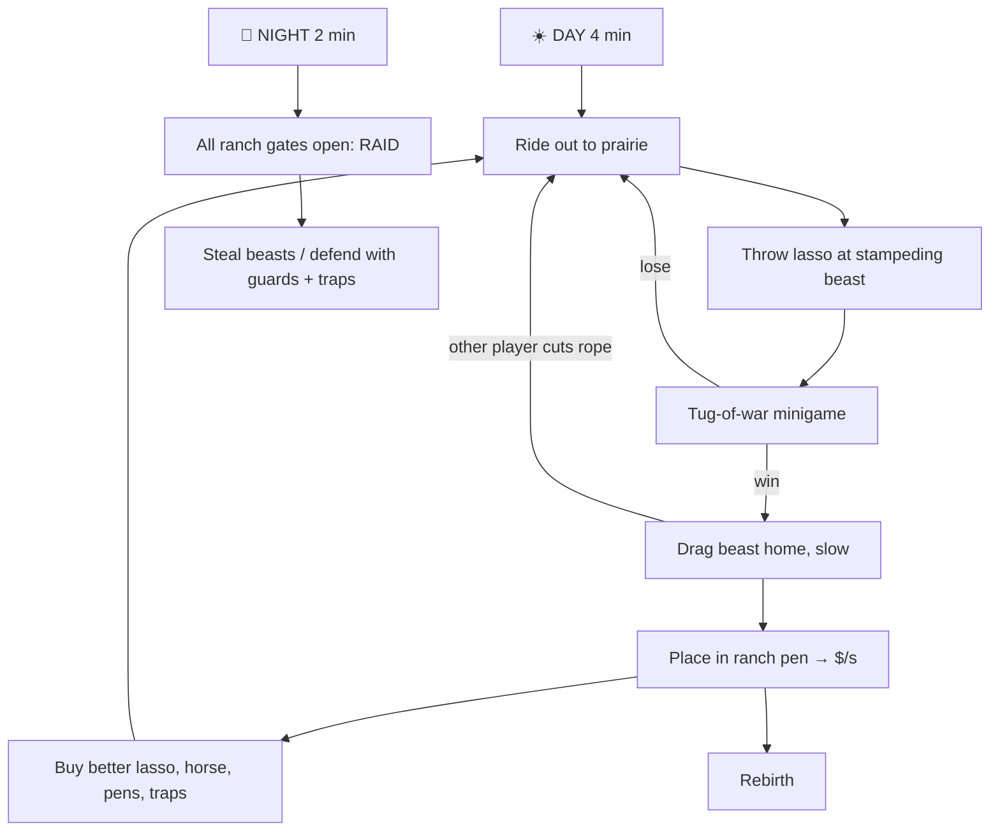

# Core Loop

## 1. Day phase (4 min): Catch
- **Stampedes** of 5–15 beasts run across the prairie every ~45 seconds. The rarer the beast, the faster it runs and the further out it spawns.
- **Biomes** gated by **Horse Speed**: Prairie → Canyon → Swamp → Volcano → Sky Mesa → Cosmic Rift.
- **Lasso:** aim and throw (mobile has a big throw button with auto-aim). On a hit, the **tug-of-war** starts:
  - A tension bar shows a moving green "sweet zone". Hold or tap to keep the marker inside it.
  - The beast's **strength** depends on its rarity, and your **lasso tier** makes the sweet zone bigger.
  - Takes about 3–8 seconds. If two players lasso the same beast, they both tug and the stronger tug wins (PvP moment).
- **Drag home:** you walk slowly with the beast in tow. Other players can **cut your rope** (one hit with a knife tool), which frees the beast so it runs off. Players can still steal during the day this way, but only out in the wild.

## 2. Night phase (2 min): Raid
- A siren plays, the sky turns purple and **every ranch gate opens**.
- Grab a beast from another ranch and carry it home. You're slowed and your lasso is disabled while carrying.
- Defenders use **guard beasts**, which have an "aggressive" trait and knock thieves back, plus **traps** (bear trap, tar pit, alarm bell).
- **Comeback rule:** a ranch can lose at most **2 beasts per night** so new players don't quit.
- An income **raid bonus** (+50% $/s for whoever stole the most) is announced at dawn.

## 3. Ranch: Earn
- Pens hold beasts, each earning $/s. Offline earnings are capped at 8 hours.
- **Breeding pen:** put in two beasts and after a timer (5–60 min) you get a baby with a chance at the next rarity tier or a mutation.

## 4. Rebirth
Requires a cash target plus specific beasts. Rewards: a cash multiplier, more pen slots, a new lasso skin and an unlocked biome. 15 tiers at launch.

## Session pacing
A day/night cycle is 6 minutes, so a typical 30-minute session has about 5 raids. Rare stampedes are announced on a timer ("🔥 LEGENDARY STAMPEDE IN 1:30"), giving players reasons to stay.

Related: [[Beasts and Rarity]] · [[Steal Genre Formula]]
