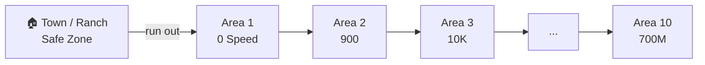
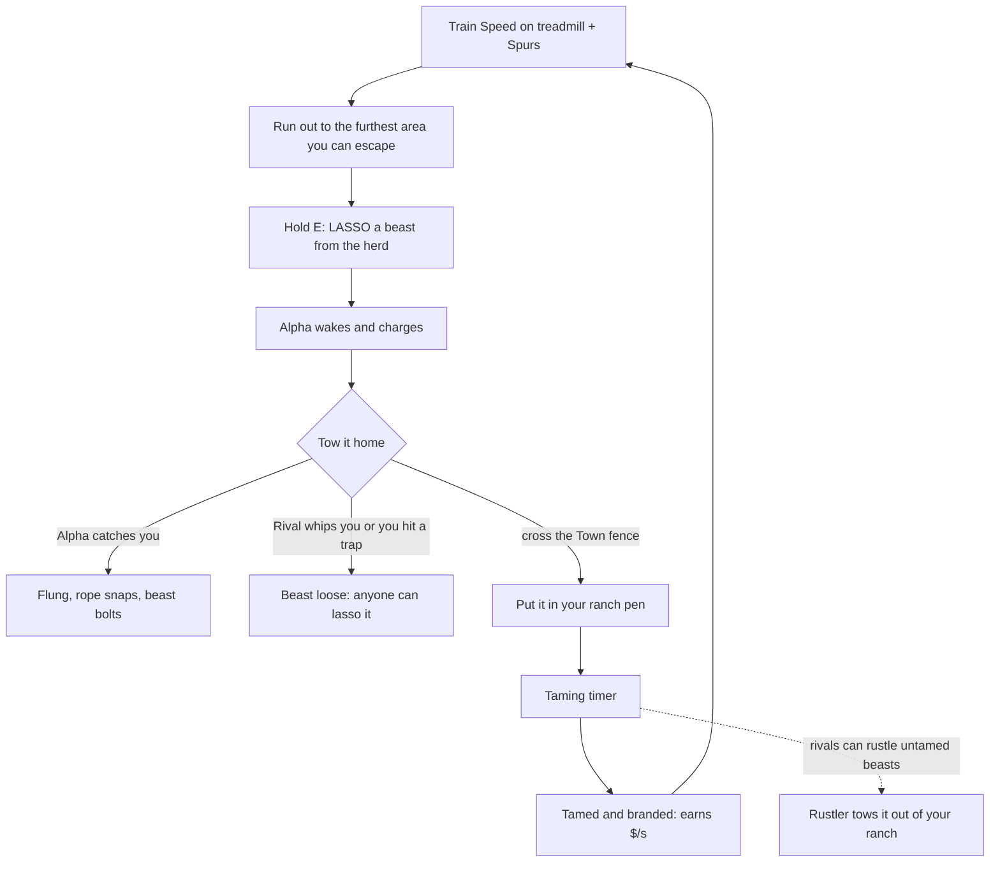

# Core Loop (v2, Steal An Egg structure)

## 1. Map layout
- **Town** sits at one end. It's the spawn and Safe Zone, with the shops, Index, Breeding Barn, Sell stand and free-rewards chest. Weapons don't work in Town and traps can't be placed there.
- **7 ranches** (one per player) line the Town's edge, each with its own **treadmill** out front. The ranch yard is outside the Safe Zone, so whips work there and rustling can happen.
- **10 areas** run in one long lane out from Town, in order. Each area entrance has a big wooden **sign** showing the Speed you need. Areas further out need more Speed and have rarer beasts, so the best beasts need the longest and riskiest run home.
- New areas are added at the far end each week.

## 2. Speed
- **Treadmill** in front of your ranch (a wagon-wheel treadmill). Each step gives +Speed. There are 11 tiers bought with cash (see [[Monetization and Launch]] and the Shop). You can stand on it while AFK.
- **Spurs** (like Steal An Egg's trails) multiply what you get from the treadmill. You equip one at a time.
- One-off Speed comes from Index claims, the free reward for liking, favouriting and joining the group (+10K), and Robux packs.
- Gates are **soft**: you can walk into any area. The sign is the Speed you need to **outrun the Alpha while towing**. Aim for about **20% above the sign**, because towing heavy beasts slows you.

## 3. The steal (in an area)
1. **Look the herd over.** 5–8 wild beasts graze around the sleeping Alpha. Each one has a tag showing its **name, rarity, weight in kg, mutation and $/s**. Mutations are also visible as a silver, golden or rainbow coat.
2. **Lasso:** hold **E** (or hold the button on mobile). It takes 0.5 s for a Common and up to 2 s for a Divine. The beast is roped and **trots behind you**.
3. **Alpha wakes** the moment you lasso. It charges at that area's chase speed, its eyes turn red, chase music starts and a danger edge pulses on screen.
4. **Towing rules:** one beast at a time. Your Speed drops by the beast's weight class (−10% to −45%). You can't use portals or the treadmill. Your **whip still works**.
5. **If the Alpha catches you,** you're flung and the rope snaps. If you're still inside its area, the beast **bolts back to the herd**. If you're further out, it **stays loose** where you fell and anyone can lasso it.
6. **Drop trick:** press **Q** to let go of the rope. The Alpha gives up and walks home, and you can re-lasso the beast (this lets you move heavy beasts in stages).
7. **Safe** once you cross the **Town fence**: the Alpha turns back. Rival players can still hit you in the ranch yard.
8. **Deliver:** walk the beast into a free **pen slot** in your ranch. It starts **taming**.

## 4. Player-vs-player
- **Whip** (starter: short range): one hit flings a towing player and their beast is knocked **loose**. Anyone nearby can press E to lasso it, including the victim. First one there wins.
- **Bear traps:** up to 3 on the map, not in Town. They root a towing player for 5 s and make them drop the beast. They also root an Alpha that's chasing.
- **Cut the rope:** a whip hit on the rope itself also frees the beast.
- **Index weapons:** completing an area's Index unlocks a stronger weapon (more knockback and range); see [[Areas and Beasts]].
- **Rare-spawn alerts** send the whole server racing to the same herd, which makes PvP hotspots.

## 5. Ranch, taming and rustling
- **Pen:** starts with **7 slots** and can be upgraded with cash up to 19. **Equip Best** fills the slots with your top earners.
- **Taming timer:** 10 s for a Common Prairie Chick, about 3–5 min for a Legendary, 1.5–3 h for Secret, 4–11 h for Eternal and 12–20 h for Divine. Heavier beasts take longer. When it hits 0, press **TAME**, play the reveal and the beast is **branded**.
- **Tamed (branded)** beasts earn **$/s automatically** with no collecting, and **can't be stolen**.
- **Rustling:** beasts **still taming** can be lassoed out of your ranch by rivals, Brainrot-style. You see a red alert and an arrow pointing at the rustler. Chase them and whip them before they leave your yard.
- **Gate lock:** your ranch gate closes for **60 s** (+10 s per pen level) with a 3-minute cooldown. You also get a 30 s lock when you join.
- **Speeding up taming:** the Sundown 30× boost, the 2× Taming pass, **Tame All** (Robux) and **Instant Tame** (Robux per beast).

## 6. Sundown (every 5 minutes)
- 4:50 of daylight is followed by a **10-second Sundown**. Everyone is teleported to Town, **every herd restocks** and taming runs **30× faster** during Sundown.
- At each restock the server rolls for rare spawns. If a **Secret, Eternal or Divine** beast spawns, a banner goes out to the whole server: *"🌈 A SECRET Inferno Mammoth roams Volcano Ridge!"*

## 7. Other systems
- **Beast Index:** first time you tame a species you **claim +Speed and cash**. Completing an area's 8 beasts gives that area's **weapon**.
- **Breeding Barn:** 3 of the same species plus a cash fee gives **1 wild calf** of that species with a re-rolled weight and a Golden or Rainbow chance. The calf goes into taming, so it can be rustled.
- **Sell stand:** sell a tamed beast, or a wild one you're towing, for a set price.
- **Stampede** (every 30 minutes): a herd of loose beasts from higher areas runs down the lane for 60 s and anyone can lasso one.
- **No rebirth** at launch, same as Steal An Egg. Progress comes from **new areas each week**.

## Session pacing
A typical 30-minute session covers 6 Sundown restocks and 1 Stampede. Train on the treadmill between runs. Heavy, rare beasts push you to go one area further than is comfortable.

Related: [[Areas and Beasts]] · [[Steal An Egg]] · [[Steal Genre Formula]]
